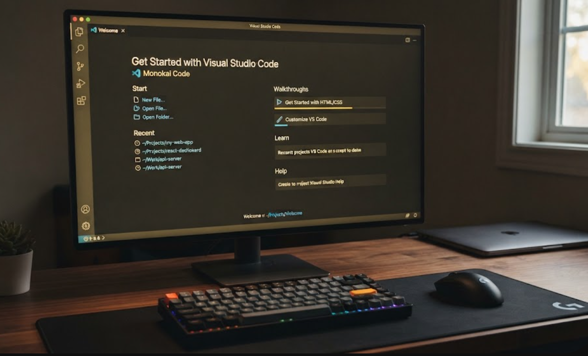

# Fitxa tècnica: Instal·lació de Visual Studio Code a Windows

## Objectiu

Instal·lar Visual Studio Code en un ordinador amb Windows per poder crear i editar fitxers de text, Markdown i codi.

## Materials

- Ordinador amb Windows
- Connexió a Internet
- Navegador web
- Instal·lador de Visual Studio Code

## Procediment

1. Obrir el navegador web.
2. Entrar a la pàgina oficial de Visual Studio Code.
3. Descarregar la versió de Visual Studio Code per a Windows.
4. Obrir el fitxer instal·lador descarregat.
5. Acceptar les opcions principals de la instal·lació.
6. Esperar que finalitzi la instal·lació.
7. Obrir Visual Studio Code per comprovar que funciona.

Per comprovar que Git està instal·lat, es pot executar la comanda següent al terminal:

```bash
git --version
```

## Comprovacions

- [ ] Visual Studio Code s'obre correctament.
- [ ] Es pot crear un fitxer amb extensió `.md`.
- [ ] Es pot obrir el terminal integrat de Visual Studio Code.
- [ ] La comanda `git --version` mostra la versió de Git.

## Incidències i solucions

| Incidència | Solució |
|---|---|
| No es troba el fitxer descarregat | Revisar la carpeta Descàrregues del navegador. |
| Visual Studio Code no s'obre | Reiniciar l'ordinador i provar de nou. |
| La comanda `git` no funciona | Comprovar que Git està instal·lat i reiniciar el terminal. |

## Imatge del procés



## Recursos

- [Pàgina oficial de Visual Studio Code](https://code.visualstudio.com/)
- [Documentació de GitHub](https://docs.github.com/)

## Flux de treball amb Git

Per versionar aquest document he seguit aquests passos:

1. He modificat el fitxer `fitxa-tecnica.md` amb Visual Studio Code.
2. He revisat l'estat del repositori amb `git status`.
3. He comprovat els canvis amb `git diff`.
4. He preparat els canvis amb `git add`.
5. He guardat cada versió amb `git commit -m`.
6. He revisat l'historial amb `git log --oneline`.
7. He sincronitzat els commits amb GitHub amb `git push origin main`.